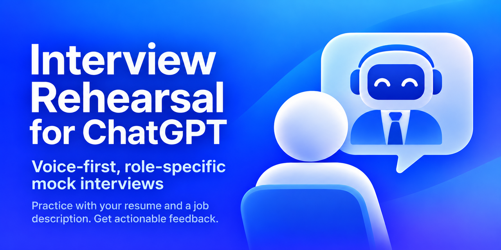

# Interview Rehearsal plugin for ChatGPT

  
   
  Free voice-first, role-specific mock interview practice plugin for ChatGPT.

**Best experienced in the ChatGPT desktop app.** Prepare in text, switch to voice in the same conversation for a natural interview rehearsal, then return to your written feedback and practice plan.

## Installing in ChatGPT

Add the GitHub marketplace **`rbonestell/chatpgt-interview-rehearsal`**, then install **Interview Rehearsal** from it.

1. Open **Plugins → Add → Add a marketplace** in ChatGPT desktop.
2. Enter `rbonestell/chatpgt-interview-rehearsal` as the source.
3. Leave the other fields empty to use the repository root and follow its default branch.
4. Select **Add marketplace** and authorize GitHub access if prompted.
5. Open **Plugins**, find **Interview Rehearsal** in the imported marketplace, and select **Install plugin**.
6. Select **Try now** to start.

## Using Interview Rehearsal

1. Start a new ChatGPT conversation.
2. Type  to select the installed plugin.
3. Tag `@Interview Rehearsal` and ask it to help you prepare: “`@Interview Rehearsal` Start a voice-first mock interview tailored to my background and a specific job opening.”
4. Provide your resume or LinkedIn profile and the job description or posting URL.

## What to try

1. Provide a job description URL (or paste the job description) and a resume PDF/DOCX (or pasted work history / accessible LinkedIn profile).
2. Confirm the role-fit analysis and select interview stage, length, difficulty, and feedback timing.
3. At the ready prompt, transition the app's voice control to start ChatGPT Voice **in the same conversation**, then say "Begin interview". You can also continue entirely in text.
4. Try "pause interview", "resume interview", "repeat the question", and "retry".
5. Finish and review the written feedback. Note whether questions were role-specific, whether follow-ups were realistic, and whether the feedback was supported by your actual answers.
6. Ask **"Create my interview prep brief as a PDF."** Save a study guide with your strongest story cues, specific improvements, practice drills, and questions for the real interviewer. The PDF uses the Interview Rehearsal icon in a simple header where the asset is accessible.

## Important notes

- The conversational workflow needs no separate API key or account. The optional interactive workspace needs a connected Interview Rehearsal MCP endpoint; packages without that connection use the same workflow in chat.
- Voice support and web/file access come from the ChatGPT host and might vary by plan or client.
- PDF prep briefs use the host's available file-creation tools. If PDF creation is unavailable, the plugin provides a readable brief you can copy into a document and save or print as a PDF.
- The plugin cannot automatically turn on voice mode or evaluate tone/body language from text transcripts.
- Your resume and job description are supplied to your own ChatGPT conversation. Avoid uploading anything confidential that you are not authorized to share.
- This plugin simulates interviews; it has no affiliation with any employer and does not predict hiring decisions.

## Privacy, terms, and support

See the [privacy policy](PRIVACY.md) for conversation and optional workspace data handling and support reports. See the [terms of use](TERMS.md) for plugin usage terms. Report problems through [GitHub Issues](https://github.com/rbonestell/chatpgt-interview-rehearsal/issues); do not include private candidate information.

## Optional interactive workspace

When the MCP connection is available, Interview Rehearsal can show a preparation checklist, setup form, ready card, session controls, and next-practice options. Intake still uses ChatGPT's native attachments and composer. Every button requests an action in the conversation; the card waits for acknowledgment before showing a changed interview state. Old cards can become stale; use the latest workspace or request a refresh.

**Prepare for voice interview** keeps your settings and waits while you select **Start voice chat** in the same conversation. Then say “Begin interview” or equivalent. **Start in text** begins immediately. Session controls do not mute the microphone or interrupt audio. Typed and spoken commands remain available if a widget or connection is unavailable.

The workspace sends minimal workflow metadata to its MCP endpoint. Keep personal details out of the short focus field; provide background and answer evidence in the conversation. The interface works without its optional host persistence feature, but does not promise durable or cross-chat session storage.

## Developing and deploying the workspace

Requires Node.js 24+. Run `npm ci`, `npm run check`, then `npm start` for a loopback MCP endpoint at `http://127.0.0.1:8787/mcp`. To run the actual Cloudflare runtime locally, build and run `npx wrangler dev`.

Cloudflare Worker configuration targets `chatgpt-interview-rehearsal-mcp.rbonestell.com`. The existing GitHub release workflow runs checks, deploys the Worker, verifies its MCP endpoint, and then bundles and attaches the connected plugin ZIP. Deployment uses repository Actions secrets `CLOUDFLARE_ACCOUNT_ID` and `CLOUDFLARE_API_TOKEN`; no GitHub environment is required. A manual **Deploy MCP to Cloudflare** workflow is also available for server-only updates. No database, Durable Object, or OpenAI API key is required.

Root `mcp.json` connects both repository marketplace installs and release ZIPs to this endpoint. Deploy the Worker before testing the connection. After deployment, `npm run configure:mcp -- https://chatgpt-interview-rehearsal-mcp.rbonestell.com/mcp` verifies the deployed version, tool, and UI resource and synchronizes the configuration; `npm run bundle` includes it in the install ZIP. Release automation always deploys and verifies the configured hostname first; repository variable `MCP_ENDPOINT` can override it. Deployment or endpoint failure stops the workflow before archive upload. If the MCP connection is unavailable, the skill continues in chat.

See [workspace development and deployment](server/README.md) for architecture, protocol versions, host testing, security, and GitHub Actions setup.

## License

See [LICENSE](LICENSE) for license terms.
